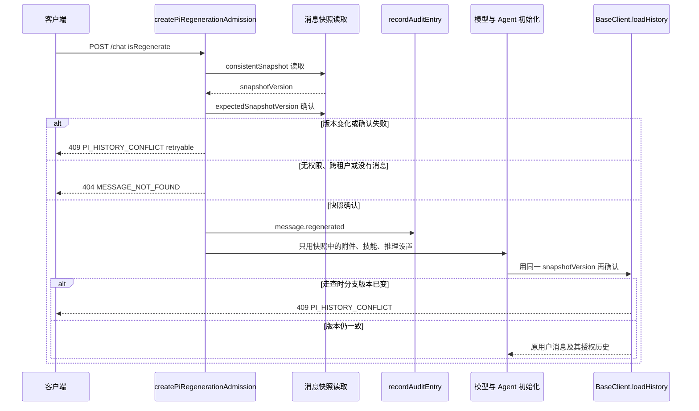

# G1：从授权历史恢复重新生成

本文是 Wave 0 / SA-2 的设计。**本次不改生产代码。** 不改 `request.js`、`client.js`、`BaseClient.js`、`initializeAgent` 或历史读取实现。失败测试留在 `api/server/controllers/agents/__tests__/trustedHistory.g1.spec.js`，在 SA-0 冻结初始化与历史接口之前保持失败。

基线是集成分支 `feature/pi-agent-runtime` 的 `61cd7fd9157133f0956f15043a2fa51da601719d`。

## 契约

从原用户消息重新生成时：

1. 在模型配置和 Agent 初始化之前，只从授权历史恢复附件、技能和推理设置。
2. 客户端重传的 `files`、`manualSkills`、`alwaysAppliedSkills`、`reasoningOverride`，以及正文和引用，不得进入本轮模型输入。存储值为空时也要清掉客户端带来的值。
3. 历史读取是一次一致快照，带版本号，并用乐观锁再确认一次。读取期间这条分支上的消息有变化，就返回可重试冲突，不调用模型，也不把已经读到的半份内容交给 Agent。
4. 未授权、跨租户、消息不存在、父消息不匹配、不是用户消息、行无法做成快照，对外是同一种拒绝，响应不泄漏正文、附件、技能、推理值或对方租户。
5. 成功选定原用户消息后、在 `next()` 和模型初始化之前，写一条不含正文的审计。

未通过 `isPiRegenerationRequest` 的编辑、继续、压缩，以及未获准的 `isRegenerate`，仍走现有拒绝。`AgentClient` 把未获准的 regenerate 放进 `unsupportedModes`，这个失败关闭保持不变。

## 现在的接缝

```text
POST /api/agents/chat
  api/server/routes/agents/index.js
    createPiRegenerationAdmission          # 私密文本检查、配置和控制器之前
      preparePiRegenerationRequest
        getMessages({ user, tenantId, conversationId, messageId })
        Object.assign(req.body, 恢复出的正文/附件/技能/引用/推理)
        admittedSnapshots WeakMap
  ResumableAgentController
    initializeClient                       # 模型配置与 Agent 初始化，读当时的 req.body
  BaseClient.setMessageOptions
    loadHistory(..., { isPiRegenerate, request, userMessageId })
      db.getMessages({ conversationId, user })
      matchesPiRegenerationSnapshot        # 只比对源用户行的整行 SHA-256
```

`getMessages` 是一次普通 `find().lean()`。消息上已有 `updatedAt` 和 `__v`，准入和历史走查都没有把它们当成锁。因此：

- 准入会在初始化之前用持久化行覆盖请求体里的正文、附件、技能、引用和推理设置。已知字段的重传目前进不了后续看到的 `req.body`。
- 覆盖结果仍放在请求体上。`handleStartMethods` 又从 `req.body.reasoningOverride` 写回用户消息。请求体不是版本化快照。
- 源用户行在两次读取之间变了，`loadHistory` 抛 `PI_REGENERATION_SOURCE_CHANGED`（`statusCode` 409），没有 `retryable`。这次检查在 Agent 初始化之后，而且只看源行。父消息或其他分支行变了、源行摘要不变时，走查成功，变化后的历史可以进入 `buildMessages`。
- 未授权、跨租户、找不到消息已经是同一种 404，固定句子，不泄漏内容。
- 没有审计写入。`AUDIT_ACTIONS` 里也没有重新生成动作。
- 控制器在 `initializeClient` 之前已经用 HTTP 200 回了 `{ status: 'started' }`。后面的历史错误进 `completeJob` 的是一段文本，不是下面的冲突对象。

## 必须先由 SA-0 冻结的接口

下面的形状是建议，不是可以现在开工的签名。SA-0 要先冻结初始化入参和历史读取，实现才能开始。冻结前改生产代码会把调用点写死在未定稿的接口上。

| 面 | 冻结时要定下来的事 |
| --- | --- |
| 历史读取 | 一次调用返回授权分支和单个不透明 `snapshotVersion`。建议过滤能表达 `consistentSnapshot` 与 `expectedSnapshotVersion`。做不到 MongoDB snapshot read concern 时，也必须在同一次逻辑读里记下版本，不能只做普通 `find` |
| 版本范围 | 版本围住用来组 prompt 的整条分支。只锁源用户行的 `` `${updatedAt}:${__v}` `` 不够：父消息或兄弟消息变了也必须冲突。`updatedAt` 缺失、不可解析，或 `__v` 不是安全整数时，这条历史不可用，按拒绝处理，不发明默认版本 |
| 初始化 | `initializeClient` / `initializeAgent` 只接收已确认快照里的附件、技能和推理设置。不得再读客户端原始副本，也不得把请求体上的同名字段当作授权依据 |
| 第二读 | `BaseClient.loadHistory` 用同一 `snapshotVersion` 再确认，失败发生在 `onHistoryLoaded` 和 `buildMessages` / `sendCompletion` 之前。`AgentClient.loadHistory` 继续把 regeneration 参数交给基类；warm event-actor 的空历史不能用于重新生成 |
| 失败出口 | 冲突在进入模型之前以 `PI_HISTORY_CONFLICT` 返回。若 HTTP `started` 已经发出，任务错误也必须是这个对象，而不是无码字符串 |
| 审计 | `createPiRegenerationAdmission` 接收 `recordAuditEntry`。动作名进入 `AUDIT_ACTIONS` 的方式一起冻结 |

两步读取使用同一个用户、租户、会话和消息标识：

1. 一致性读，记下 `snapshotVersion`。
2. 乐观确认。确认行的版本必须相同，且 `snapshotPiRegenerationUser` 仍成功。

版本不同、确认读找不到行，或两步摘要不一致，都是冲突。不得用第一步的行继续，也不得 `next()`。快照可以仍放在现有 `admittedSnapshots` WeakMap，但必须带上 `snapshotVersion`。WeakMap 不是跨副本的锁；第二读要再打到存储。

## 失败语义

| 情况 | HTTP | 响应 | 可重试 |
| --- | --- | --- | --- |
| 未登录、没有用户标识、租户或会话不一致、消息不存在、父消息不对、不是用户消息、行无法做成快照 | 404 | `{ "code": "MESSAGE_NOT_FOUND", "error": "The original user message is unavailable for regeneration." }` | 否 |
| 两次读取之间版本变化，包括源行或其他分支行 | 409 | `{ "code": "PI_HISTORY_CONFLICT", "retryable": true, "error": "The conversation changed. Retry the regeneration." }` | 是 |

404 不说明是哪一个条件失败，不回显客户端提交的内容，也不回显服务端行里的正文、附件、技能、推理值或租户。不调用模型，也不调用 Agent 初始化。

`retryable: true` 表示客户端可以重新发起同一次重新生成。服务端不自动再读、不沿用旧快照、不调用模型。`loadHistory` 抛出的对象使用同样的 `code`、`retryable: true` 和 `statusCode: 409`。

现有 `PI_REGENERATION_SOURCE_CHANGED` 只说明源行摘要在初始化之后对不上。G1 用 `PI_HISTORY_CONFLICT` 作为对外冲突，不再增加一种客户端要分别处理的 409。

存储或网络失败沿用现有操作失败映射，不伪装成找不到消息，也不把查询或行内容写进响应。

## 最终输入

模型配置、`initializeAgent` 和 `handleStartMethods` 使用的附件、技能和推理设置只取自已确认的快照：

| 快照字段 | 进入本轮的位置 |
| --- | --- |
| `fileIds` 与行上的 `files` | 本轮附件。不用客户端 `files`，也不用初始化阶段另存的请求附件 |
| `manualSkills` | 主 Agent 的手动技能 |
| `alwaysAppliedSkills` | 本轮已经固定的自动技能 |
| `reasoningOverride` | 本轮推理设置 |

请求体上的同名字段可以继续被覆盖，避免旧调用点读到客户端原值。覆盖不是授权依据。客户端在准入之后再次改写 `req.body`，最终用户消息仍必须与快照一致。

## 审计

成功选定原用户消息并且快照已确认后，在 `next()` 和模型初始化之前写一条：

```text
action: message.regenerated
outcome: success
actor: { type: 'user', id: <当前用户> }
target: { type: 'message', id: <原用户消息 id> }
metadata: { conversationId, snapshotVersion }
```

`id` 是客户端已经提交、并且已被授权确认的 `overrideParentMessageId`。元数据只有会话标识和版本。不写正文、附件名、文件 id、技能名、推理取值或客户端重传内容。

`message.regenerated` 目前不在 `AUDIT_ACTIONS` 中。实现时再扩展枚举。拒绝和冲突不写带内容的审计；是否另记一条不含内容的拒绝审计留给 SA-0 和实现，当前测试不要求它。

## 调用顺序



## 测试

`trustedHistory.g1.spec.js` 走真实的 `createPiRegenerationAdmission` 和 `BaseClient.loadHistory` / `handleStartMethods`。文件头写明：不要为了让它们变绿而改生产代码。

已经按现有代码成立、用真实断言锁住的行为：客户端重传的附件、技能和推理设置被忽略；未授权、跨租户、缺失消息是同一种 404，不调用初始化，响应不泄漏。

在接口冻结并实现之前会失败的行为：读取期间版本变化返回可重试的 `PI_HISTORY_CONFLICT` 且不初始化 Agent；源行或分支上其他消息变化时，不把历史交给模型；从原用户消息建成回合时写入不含正文的 `message.regenerated`。
