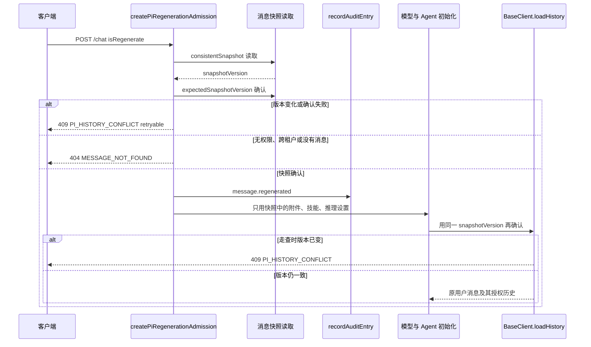

# G1：重新生成只信任已授权历史

本说明只定义「从原用户消息重新生成」在模型配置和 Agent 初始化之前如何恢复附件、技能和推理设置。接口尚未冻结。本分支不改请求控制器、历史加载或 Agent 初始化的生产代码；对应失败测试在 `api/server/controllers/agents/__tests__/trustedHistory.g1.spec.js`。

## 目标

客户端可以重传 `files`、`manualSkills`、`alwaysAppliedSkills`、`reasoningOverride` 和正文。这些字段不得进入本轮模型输入。本轮输入只来自当前用户、当前租户、当前会话里那条已持久化的用户消息。

读取必须带一致性快照和版本，并用乐观锁再确认一次。读取期间该消息的版本变了，就返回可重试冲突，不调用模型，也不把已经读到的半份内容交给 Agent。未授权、跨租户、消息不存在使用同一种拒绝，响应里不出现消息正文、附件标识、技能名或推理取值。成功选定原用户消息时写一条不含正文的审计记录。

未通过 `isPiRegenerationRequest` 的编辑、继续、压缩，以及未获准的 `isRegenerate`，仍走现有拒绝。`AgentClient` 在约 5855 行把未获准的 regenerate 放进 `unsupportedModes`，这个失败关闭保持不变。

## 现有接缝

```text
POST /api/agents/chat
  api/server/routes/agents/index.js
    createPiRegenerationAdmission          # 私密文本检查、配置和控制器之前
      preparePiRegenerationRequest
        getMessages({ user, tenantId, conversationId, messageId })
        Object.assign(req.body, 恢复出的正文/附件/技能/引用/推理)
        admittedSnapshots WeakMap
  ResumableAgentController
    initializeClient                       # 模型配置与 Agent 初始化，读 req.body
  BaseClient.setMessageOptions
    loadHistory(conversationId, userMessageId, { isPiRegenerate, request, userMessageId })
      db.getMessages({ conversationId, user })
      matchesPiRegenerationSnapshot        # 整行 SHA-256，不一致则 409
  AgentClient.loadHistory                  # 把 regeneration 原样交给 BaseClient
```

`packages/data-schemas` 的 `getMessages` 是一次 `find().lean()`，没有 snapshot read concern，也没有版本谓词。消息文档已有 `updatedAt` 和 `__v`，准入和历史走查都没有把它们当作乐观锁。

因此今天的行为是：

- 准入会用持久化行覆盖请求体里的正文、`files`、`manualSkills`、`alwaysAppliedSkills`、`quotes`、`reasoningOverride`。覆盖发生在模型配置之前，所以这些已知字段的重传目前进不了后续读取的 `req.body`。
- 覆盖结果仍放在客户端请求体上。后续 `handleStartMethods` 又从 `req.body.reasoningOverride` 写回用户消息。请求体不是版本化的服务端快照。
- 冲突要到 `BaseClient.loadHistory` 才出现，错误码是 `PI_REGENERATION_SOURCE_CHANGED`，没有 `retryable`。这次检查在 Agent 初始化之后。
- 未授权、跨租户、找不到消息都变成同一种 `404`，正文是固定句子。这一点已经不泄漏内容。
- 没有任何审计写入。`AUDIT_ACTIONS` 里也还没有重新生成动作。

## 快照、版本与乐观锁

新增一次服务端读取，放在 `preparePiRegenerationRequest` 里，仍由 `createPiRegenerationAdmission` 在模型配置和 `initializeClient` 之前调用。不要在 `request.js` 或 `initialize.js` 里再读一遍客户端字段来做决定。

版本：

```text
snapshotVersion = `${updatedAt 的 ISO 时间}:${__v}`
```

`updatedAt` 缺失、不是可解析时间，或 `__v` 不是安全整数时，这条历史不可用，按下面的拒绝处理，而不是挑一个默认版本继续。

读取分两步，使用同一个用户、租户、会话和消息标识：

1. 一致性读。调用方传入 `consistentSnapshot: true`。实现优先使用 MongoDB snapshot read concern；做不到时必须在同一次逻辑读里记下 `snapshotVersion`，不能只做普通 `find`。
2. 乐观确认。用第一步的 `snapshotVersion` 再读，过滤条件带 `expectedSnapshotVersion`。确认行的版本必须相同，且 `snapshotPiRegenerationUser` 仍成功。

两步之间版本不同、确认读找不到行，或两步摘要不一致，都是冲突。不得用第一步的行继续，也不得 `next()`。

建议把这两步收成 `packages/data-schemas` 的一个方法，例如 `readMessageSnapshot`，返回普通对象 `{ row, snapshotVersion }` 或带稳定错误码的结果。`getMessages` 的现有签名继续给普通历史走查用。控制器只接收已经校验过的快照。

快照仍放在现有 `admittedSnapshots` WeakMap 中，并带上 `snapshotVersion`。`matchesPiRegenerationSnapshot` 除了整行摘要，还要比较这个版本。摘要继续覆盖正文、附件、技能、引用和推理设置；版本用来发现“内容看起来还在，但行已经被写过”的更新。

`BaseClient.loadHistory` 在 `isPiRegenerate` 时用同一版本再确认源消息。确认失败时抛出与准入相同的冲突，并且发生在 `onHistoryLoaded` 之前。`AgentClient.loadHistory` 继续把 `regeneration` 参数交给基类；warm event-actor 的空历史短路不能用于重新生成。

## 冲突

```json
{
  "code": "PI_HISTORY_CONFLICT",
  "retryable": true,
  "error": "The conversation changed. Retry the regeneration."
}
```

HTTP 状态 `409`。`loadHistory` 抛出的对象使用同样的 `code`、`retryable: true` 和 `statusCode: 409`。

`retryable: true` 表示客户端可以重新发起同一次重新生成。服务端不自动再读、不沿用旧快照、不调用模型。响应和错误对象都不包含消息正文、附件标识、技能名、推理取值、租户标识或行的原始内容。

现有 `PI_REGENERATION_SOURCE_CHANGED` 只说明摘要在初始化之后对不上。G1 用 `PI_HISTORY_CONFLICT` 替换这条对外冲突，而不是再增加一种客户端要分别处理的 409。

## 拒绝

未登录或没有用户标识、租户不一致、会话不一致、消息不存在、父消息对不上、行不是用户消息、行无法做成快照，全部返回同一种响应：

```json
{
  "code": "MESSAGE_NOT_FOUND",
  "error": "The original user message is unavailable for regeneration."
}
```

HTTP 状态 `404`。不返回是哪一个条件失败，不回显客户端提交的正文或服务端行里的正文、附件、技能和推理设置。不调用模型或 Agent 初始化。

这就是 `createPiRegenerationAdmission` 今天对 `kind: 'unavailable'` 的形状。G1 保持它，不用更细的错误码把跨租户和“没有这条消息”区分开。

## 最终输入

模型配置、`initializeAgent` 和 `handleStartMethods` 使用的附件、技能和推理设置只取自已确认的快照：

| 快照字段                   | 进入本轮的位置                                               |
| -------------------------- | ------------------------------------------------------------ |
| `fileIds` 与行上的 `files` | 本轮附件，不用客户端 `files`，也不用初始化阶段另存的请求附件 |
| `manualSkills`             | 主 Agent 的手动技能                                          |
| `alwaysAppliedSkills`      | 本轮已经固定的自动技能                                       |
| `reasoningOverride`        | 本轮推理设置                                                 |

请求体上的同名字段可以继续被覆盖，避免旧调用点读到客户端原值。覆盖不是授权依据。授权依据是带 `snapshotVersion` 的快照。客户端在准入之后再次改写 `req.body`，最终用户消息仍必须与快照一致。

## 审计

成功选定原用户消息、并且快照已确认后，在 `next()` 和模型初始化之前写一条审计：

```text
action: message.regenerated
outcome: success
actor: { type: 'user', id: <当前用户> }
target: { type: 'message', id: <原用户消息 id> }
metadata: { conversationId, snapshotVersion }
```

`recordAuditEntry` 由路由把依赖传给 `createPiRegenerationAdmission`。元数据只有会话标识和版本。不写正文、附件名、技能名、推理取值或客户端重传内容。

`message.regenerated` 目前不在 `AUDIT_ACTIONS` 中。实现时再扩展枚举和分类，本分支不改。拒绝和冲突不写带内容的审计；是否另记一条不含内容的拒绝审计留给实现，测试不要求它。

## 调用顺序



## 测试所锁定的行为

`trustedHistory.g1.spec.js` 走真实的 `createPiRegenerationAdmission` 和 `BaseClient.loadHistory` / `handleStartMethods`。文件头写明这些测试等待 G1，本分支禁止为了让它们变绿而改生产代码。

- 客户端重传被忽略：准入之后，最终用户消息和请求体中的附件、手动技能、自动技能、推理设置等于授权行，不等于重传值。
- 读取期间冲突：注入的读取第一次返回版本 4、第二次返回版本 5。期望确认读发生，Agent 初始化不被调用，响应为可重试的 `PI_HISTORY_CONFLICT`，且不含两边的正文。
- 走查冲突：准入之后历史读取看到新版本。期望在 `onHistoryLoaded` 和模型构建之前抛出同一种可重试冲突。
- 未授权、跨租户、消息不存在：同一种 404，初始化不被调用，响应序列化结果不含授权正文、重传正文、附件标识和技能名。
- 端到端审计：从原用户消息建成回合后，`recordAuditEntry` 收到 `message.regenerated`，参数里没有消息正文。
